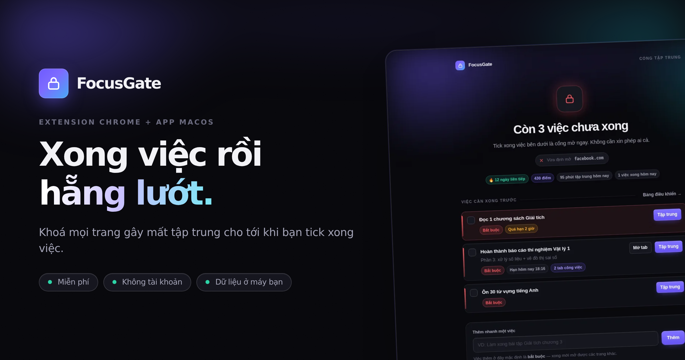
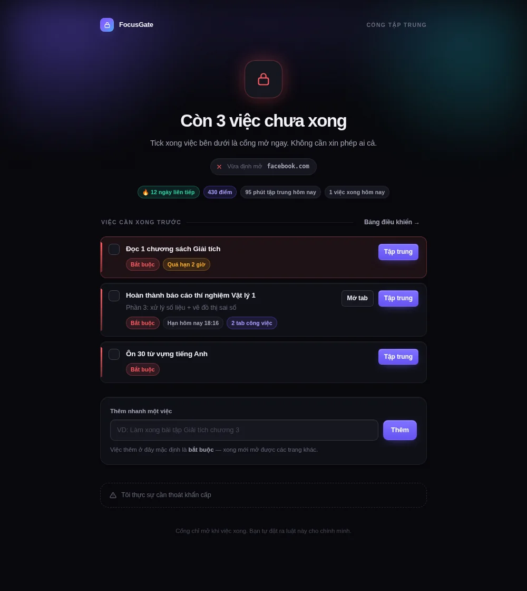
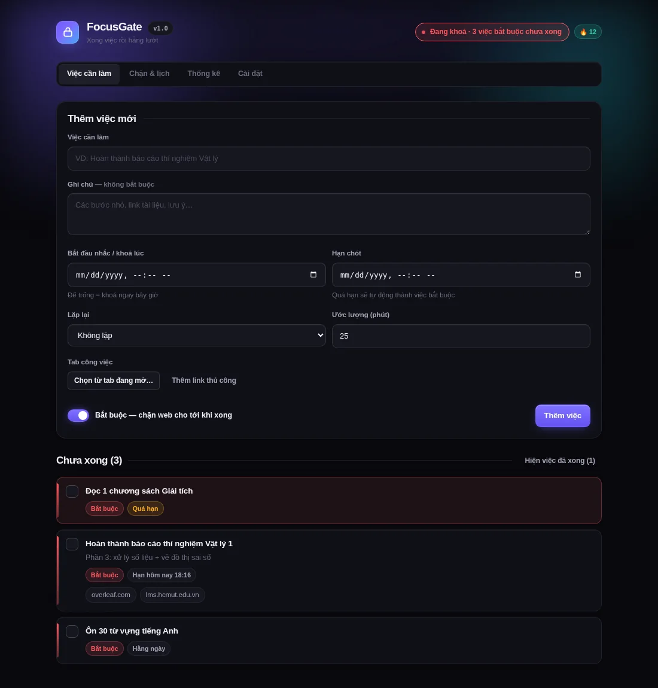
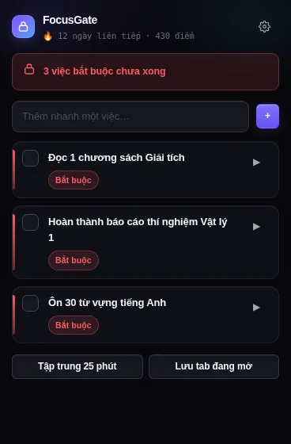
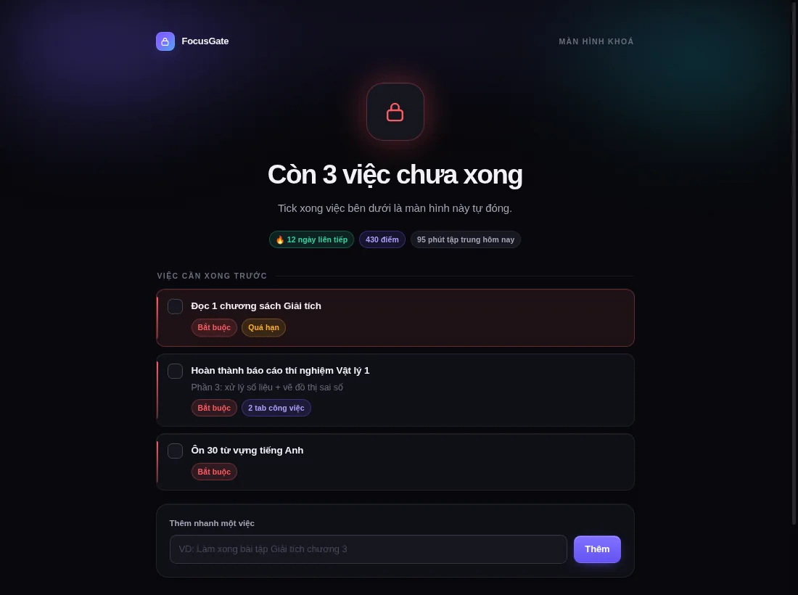

# FocusGate

**Xong việc rồi hẵng lướt.** Extension chặn web và app khoá màn hình cho macOS: chừng nào việc bắt buộc trong ngày chưa xong thì Facebook, TikTok, YouTube và các app bạn chọn vẫn bị khoá. Tick xong việc, cổng mở, và nó đưa bạn về đúng trang vừa định vào.



Không máy chủ, không tài khoản. Mọi dữ liệu nằm trên máy bạn.

| Trang chặn | Bảng điều khiển | Popup | Màn hình khoá macOS |
|---|---|---|---|
|  |  |  |  |

## Nó làm gì

- **Ghi việc kèm hạn chót và cụm tab công việc.** Việc đánh dấu "bắt buộc" sẽ khoá cổng cho tới khi bạn tick xong.
- **Chặn ở tầng mạng** bằng `declarativeNetRequest`: gõ thẳng địa chỉ, bấm link hay mở tab mới đều không lọt. Tab đang mở sẵn cũng bị kéo về trang chặn.
- **Lối thoát khẩn cấp có giá.** Muốn lướt sớm thì phải chờ 30 giây, gõ tay câu cam kết 121 ký tự (dán không tính), mất chuỗi ngày, trừ 50 điểm, mỗi ngày tối đa 2 lượt. Ai muốn chặt hơn có thể tắt hẳn lối thoát.
- **Không có cửa sau.** Khi đang khoá thì không xoá được việc bắt buộc, không tắt được khung giờ đang chạy, không đổi sang chế độ nhẹ, không thêm trang giải trí vào danh sách trắng, không xoá sạch dữ liệu.
- **App desktop cho macOS** bật cùng máy, hiện màn hình khoá toàn màn hình khi còn việc, và ẩn các app bị chặn ngoài trình duyệt.
- **Hai phần tự đồng bộ** qua `127.0.0.1:47823`. Máy chủ chỉ nhận yêu cầu từ extension, từ chối mọi trang web khác (kể cả kiểu tấn công DNS rebinding), và không để bản cũ ghi đè thay đổi mới.
- Thêm: khung giờ khoá theo lịch, Pomodoro, điểm và chuỗi ngày, thống kê 14 ngày, giao diện tối/sáng.

## Cài đặt

**Extension (Chrome, Edge, Brave, Cốc Cốc, Arc)**

1. Tải `focusgate-extension.zip` ở mục [Releases](../../releases) rồi giải nén vào một chỗ cố định. Hoặc clone repo này và dùng thư mục `packages/extension`.
2. Mở `chrome://extensions`, bật **Developer mode**.
3. Bấm **Load unpacked**, chọn thư mục có tệp `manifest.json`.

**App desktop macOS** (cần [Node.js](https://nodejs.org) bản LTS)

```bash
git clone <địa chỉ repo này> && cd focusgate
./0-Tao-app-desktop.command      # cài thư viện, đóng gói, ký ad-hoc, chép vào /Applications
```

Hướng dẫn đầy đủ (quyền macOS, Safari, khoá cứng extension, gỡ cài đặt) nằm trong [HUONG-DAN.md](HUONG-DAN.md).

## Phát triển

```text
packages/core/        logic dùng chung: quyết định chặn, lịch, điểm, Pomodoro
packages/extension/   Chrome MV3: service worker, luật chặn, trang chặn, bảng điều khiển, popup
packages/desktop/     Electron: màn hình khoá, tray, canh app, máy chủ đồng bộ
tests/e2e/            kiểm thử trên Chromium thật và Electron thật
brand/  web/  social/ bộ nhận diện, landing page song ngữ, ảnh quảng bá
video/                pipeline quay và dựng video giới thiệu (xem bên dưới)
```

```bash
npm install
npm run build          # đồng bộ core sang hai gói + đóng gói extension
npm test               # 88 unit test
npm run e2e:setup      # cài Playwright (một lần)
npm run test:all       # đủ 137 bài: unit, extension, desktop, tích hợp
```

Kết quả chi tiết: [KIEM-THU.md](KIEM-THU.md). Kiểm thử E2E và desktop trên Linux cần `xvfb-run`.

## Video giới thiệu

Video trong mục Releases được dựng hoàn toàn bằng mã trong `video/`, từ footage quay app thật:

```bash
npm run video                  # 2 video demo (bản im lặng, Việt + Anh)
npm run video:tiktok:setup     # tải giọng đọc, mô hình nhận dạng, font (một lần)
npm run video:tiktok           # clip TikTok tiếng Việt có lồng tiếng + nhạc nền
```

Clip TikTok dùng giọng đọc offline Piper `vi_VN-vais1000-medium` qua [sherpa-onnx](https://github.com/k2-fsa/sherpa-onnx), có kiểm chứng độ rõ bằng nhận dạng giọng nói ngược. Nhạc nền và hiệu ứng được tổng hợp bằng numpy, không dùng mẫu có sẵn.

## Giới hạn

- Tắt extension ở `chrome://extensions` hoặc dùng trình duyệt chưa cài thì không chặn được. HUONG-DAN.md có cách khoá cứng bằng chính sách của Chrome.
- App desktop hiện chỉ có bản macOS. Extension chạy được trên mọi trình duyệt nhân Chromium, kể cả trên Windows.
- Giao diện mới có tiếng Việt.

## Ghi nguồn

- Font [Be Vietnam Pro](https://github.com/bettergui/BeVietnamPro) (SIL Open Font License).
- Giọng đọc trong video: Piper `vi_VN-vais1000-medium`, huấn luyện trên bộ dữ liệu VAIS-1000 (CC BY 4.0).

## Giấy phép

[MIT](LICENSE) © 2026 Lê Hoàng Vũ
